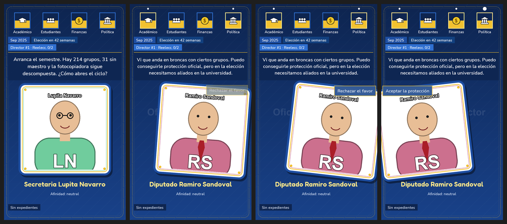

# Manual de desarrollo: Fin de la Gestión

> 🎮 Aplicación del *Manual de desarrollo de videojuegos* (Centro de Cultura Digital, 2017) a **Fin de la Gestión**.
> Universidad Autónoma de Nayarit · Unidad Académica de Economía · Noviembre 2026

---

## Desarrollo de videojuegos

**Fin de la Gestión** es un juego de cartas de decisiones en el que el jugador dirige la Unidad Académica de Economía de la Universidad Autónoma de Nayarit. Cada carta es una semana: se desliza a la izquierda o a la derecha para decidir, y cada decisión mueve cuatro indicadores (Académico, Estudiantes, Finanzas y Política). Si uno llega a 0 o a 100, el director cae y la historia sigue con su sucesor.

Se sigue el mismo orden que el manual: herramientas, componentes, preparación (investigación, conceptualización, calendarización, preproducción, desarrollo y lanzamiento) y los ejercicios de cada sección, resueltos para este proyecto.

### Herramientas / utensilios

| Herramienta del manual | Lo que usa este proyecto |
|---|---|
| Computadora personal (PC) | PC con Windows 11. |
| Periféricos | Teclado y ratón. El juego se controla arrastrando la carta (ratón o pantalla táctil) o con las flechas ← / → / ↑. |
| Motor de desarrollo (*Engine*) | **GDevelop 5**. La lógica está escrita como eventos JavaScript (`src/js/*.js`) que un script inserta en el proyecto `game.json`. |
| Software de producción (*Middleware*) | Node.js (build, simulador, lint, editor web de cartas y balance), Python + numpy (genera audio, sprites provisionales y métricas de fuente), ffmpeg (codifica OGG). |
| Archivos de sonidos e imágenes | Audio sintetizado por código con licencia CC0; fuentes Nunito y Fredoka (SIL OFL); sprites provisionales mientras se dibuja el arte final (lista en `SPRITES.txt`). |
| Control de código fuente | Git. |
| Sitio web o repositorio | GitHub: `github.com/brayort/videojuego`. |

**Lista**

- [x] Computadora personal (PC)
- [x] Periféricos
- [x] Motor de desarrollo (GDevelop 5)
- [x] Software de producción (Node, Python)
- [x] Archivos de sonidos e imágenes
- [x] Control de código fuente (Git)
- [x] Sitio web o repositorio (GitHub)

---

## Componentes

La lista del manual se divide en mecánicas y dinámicas, narrativa y estética. En este juego la **mecánica** es la regla «desliza para decidir, cada opción suma o resta a cuatro indicadores y en 0 o 100 caes»; la **dinámica** es lo que surge al jugar: el jugador aprende a no complacer demasiado a nadie, porque un indicador en 100 también te tumba. La **estética** busca tensión y sátira institucional, y la narrativa conduce al jugador por la historia de la UAN a lo largo de varios directores.

### Mecánicas y dinámicas de juego

- **Mapas / mundos:** la Unidad de Economía dentro de la UAN y el estado de Nayarit.
- **Niveles:** cada director es una partida; la historia dura hasta 8 directores.
- **Rompecabezas:** 4 minijuegos (presupuesto, prensa, plagio y consejo).
- **Recompensas:** reelección y 35 logros.
- **Obstáculos:** 362 cartas con dilemas; elecciones cada mandato.
- **Dificultad:** equilibrar 4 indicadores que matan en 0 y en 100; integridad oculta.
- **Ritmo:** 1 carta = 1 semana, desde septiembre de 2025; calendario académico, Mundial 2026, elecciones intermedias.
- **Coleccionables:** 13 expedientes que desbloquean la opción ↑.

### Narrativa

- **Tema:** la gestión universitaria: dinero, sindicato, estudiantes, política estatal y corrupción.
- **Técnica:** narrativa ramificada por banderas, cartas encadenadas y una dinastía de directores.
- **Personajes:** 37 (rector, tesorero, líder sindical, reportero, auditora, estudiantes wixárika y náayeri…).
- **Antagonistas:** diputado, empresa fantasma, porro de la facultad, aspirante a rector.
- **Conflictos:** huelga del SPAUAN, pensiones, plagio, huracán, inseguridad.
- **Soluciones:** 6 caídas especiales y 9 destinos finales de la UAN y de Nayarit hacia 2040.
- **Ritmo de la historia (*pacing*):** cinemáticas tipo novela visual en la introducción, la historia y los destinos.

### Estética

- **Gráficos:** pantalla vertical 720×1280, paleta azul, blanco y amarillo.
- **GUI:** barra de 4 indicadores, fecha, contador a la elección, afinidad, expedientes, menú, pausa, logros, ranking y crónica.
- **Animación:** carta que se inclina al arrastrarla, transiciones, cinemáticas.
- **Efectos especiales:** partículas (lluvia del huracán), destellos, vibración.
- **Sonido FX:** 16 efectos. **Música:** 3 loops (oficina, campaña, destino).
- **Licencias:** fuentes OFL, audio CC0.
- **Publicidad:** pendiente (ver Lanzamiento).

### Licencias

GDevelop es software libre (MIT). Las fuentes Nunito y Fredoka usan la SIL Open Font License, que permite incluirlas en el juego. Todo el audio se generó por código propio y se publica como CC0, así que no hay que dar crédito a terceros. Los nombres de personajes son ficticios.

### Interfaz gráfica (GUI)

Es el primer contacto con el jugador. Arriba están los cuatro indicadores con icono; debajo, la fecha, las semanas que faltan para la elección y el número de director. En el centro, la pregunta y la carta del personaje; al arrastrarla aparece el texto de la opción. Abajo, el nombre del personaje, su afinidad y los expedientes. Una herramienta del proyecto marca en rojo cualquier texto que no cabe en su caja, para que la información siempre se lea completa.

---

## Preparación

El manual advierte que empezar con una historia ya decidida suele frustrar, y que lo más importante es diseñar y probar las mecánicas. Por eso el proyecto empezó con un juego pequeño y conocido en su forma (cartas de dos opciones) y con lo que el autor sabe hacer: programar. El arte quedó con sprites provisionales hasta tener las mecánicas probadas, y el contenido (las cartas) vive en un archivo JSON aparte para crecer sin tocar el código.

| Etapa (manual) | Qué incluye en este juego | Estado |
|---|---|---|
| 1. Investigación | Licencias, motor (GDevelop), plataforma (web y móvil vertical), historia y contexto de la UAN y Nayarit, mecánicas de juegos de cartas de decisión. | ✅ Hecho |
| 2. Conceptualización | Mapas (UAN / Nayarit), personajes, obstáculos, GUI, mecánicas, historia, recompensas, logros, habilidades (expedientes), paleta, música. | ✅ Hecho |
| 3. Calendarización | Prueba de juego, arte, programación, lanzamiento (ver «Calendarizar»). | ✅ Hecho |
| 4. Preproducción | Prototipo jugable con sprites provisionales y simulador por bots. | ✅ Hecho |
| 5. Desarrollo | Alfa: mecánicas, minijuegos, audio. Beta: cinemáticas, herramientas, paleta y fuentes finales. | 🔄 En curso (beta) |
| 6. Postproducción | Enriquecer (arte final de SPRITES.txt), pulir, probar, datos estadísticos (reporte de balance y ranking). | ⏳ Pendiente |
| 7. Lanzamiento | Lanzamiento suave en la Unidad de Economía y después público. | ⏳ Pendiente |

---

## Investigación

Para la investigación se usó el **Lienzo de modelado de juegos** (*Game Model Canvas*). Las decisiones que más pesaron:

- **Plataforma.** El público (estudiantes y profesores) juega sobre todo en el celular, así que la pantalla es vertical (720×1280) y todo se controla con un dedo. GDevelop exporta a web, Android y PC sin cambiar el juego.
- **Estética según el dispositivo.** En un celular los detalles finos se pierden: se usan tarjetas grandes, iconos simples y fuentes redondeadas (Nunito y Fredoka) que se leen bien en pantallas chicas.
- **Licencias.** Se eligieron recursos que se pueden redistribuir sin problemas legales: motor MIT, fuentes OFL, audio propio en CC0.
- **Locaciones e historia.** El juego está ambientado en un lugar real (UAN, Tepic, Sayulita, la sierra), así que se documentaron temas reales: pensiones y subsidio, sindicato SPAUAN, acreditaciones, migración de jóvenes, seguridad, huracanes y comunidades wixárika y náayeri. Los personajes son ficticios.
- **Estudio de mercado.** Los juegos de cartas de decisión de dos opciones ya han demostrado que funcionan en móvil y no hay uno sobre la vida universitaria en Nayarit: ese es el «gancho».

### Lienzo de modelado de juegos

**Nombre del proyecto:** Fin de la Gestión · **Diseñado para:** comunidad UAN · **Diseñado por:** HectorUwO · **En:** GDevelop 5 · **Iteración:** 1.0 (beta)

| Casilla | Contenido |
|---|---|
| 🖥️ **Plataformas** | Web (navegador del celular o PC), Android y PC de escritorio. Pantalla vertical 720×1280; control por arrastre táctil, ratón o teclado. Las mecánicas solo requieren arrastrar a un lado: funcionan igual en todas. |
| ⚙️ **Mecánicas** | Desliza la carta a la izquierda o a la derecha para decidir. Cada opción suma o resta a Académico, Estudiantes, Finanzas y Política. Un indicador en 0 o en 100 = caída del director. Hacia arriba: usar un expediente. Elección: hay que ganar votos para reelegirse. La dificultad crece: cartas por umbral, eras y consecuencias encadenadas. |
| 🧩 **Componentes** | Puntos (4 indicadores + 6 medidores de la UAN y Nayarit). Logros (35). Niveles (directores). Tabla de clasificación (ranking). Cuenta regresiva (elección). Inventario (expedientes). Aleatorio (mazo y eventos). |
| ↔️ **Dinámicas** | Estatus (director, reelecciones). Progresión (semanas, directores, dinastía). Escasez (presupuesto, aliados). Recompensa (logros, destinos). Identidad (rasgos del director, integridad oculta). |
| 🖼️ **Estética** | Reto: sobrevivir el mayor tiempo posible. Narrativa y descubrimiento: 362 cartas y 9 destinos. Expresión: decidir si ser íntegro o corrupto. Sensación: tensión, humor y sátira institucional. |
| 🏃 **Comportamientos** | Leer cada carta antes de decidir. Volver a jugar con otro director. Comparar destinos en la Crónica. Recomendar el juego a compañeros. Competir en el ranking. |
| 👥 **Jugadores** | Estudiantes y profesores de la UAN (18 a 50 años). Juegan en ratos cortos en el celular. Les interesa reconocer su universidad y reírse de la política interna. |

---

## Conceptualización

Del lienzo salieron los puntos que el manual pide revisar:

| Punto del manual | En Fin de la Gestión |
|---|---|
| Objetivo general | Dirigir la Unidad de Economía el mayor tiempo posible y dejar a la UAN y a Nayarit en el mejor destino. |
| Objetivos específicos | Mantener los 4 indicadores entre 0 y 100, ganar las elecciones, conseguir expedientes y logros. |
| Reglas fáciles y coherentes | Una sola acción (deslizar). Las consecuencias tienen sentido en el contexto: pagar al sindicato baja Finanzas y sube Estudiantes. |
| Juego balanceado | Un simulador juega 5000 partidas con tres bots. El bot equilibrado dura una media de 83.5 semanas y el aleatorio 30.2: jugar bien sí se nota. El reporte también señala qué indicador mata más para corregir cartas. |
| Nivel de dificultad | Al principio pocas cartas fuertes; después aparecen crisis por umbrales (huelga, rescate federal, intervención del Congreso). |
| Sentido de control | La carta se inclina mientras se arrastra y muestra la opción antes de soltarla. |
| Retroalimentación y recompensas | Los indicadores suben o bajan con animación y sonido; avisos de logro; epílogo y crónica al caer. |
| Gancho | Es tu universidad: personajes, lugares y problemas reconocibles, y cada caída cambia la historia del siguiente director. |

---

## Calendarizar

El trabajo se dividió en programación, diseño de juego y arte y sonido. Como es un juego 2D, el arte final no bloquea a la programación: se trabajó con sprites provisionales (el código ignora animaciones que aún no existen) y primero se cerraron las mecánicas principales. Las fechas con ✅ salen del historial de Git; las demás aún no tienen fecha, y conviene fijarlas para no perder el ritmo, como recomienda el manual.

| Etapa | Programación | Diseño de juego | Arte y sonido | Fecha |
|---|---|---|---|---|
| Prototipo | Motor de cartas e indicadores | Primeras cartas y finales | Sprites provisionales | 29 oct 2026 ✅ |
| Mecánicas centrales | Minijuegos, elección, sucesión | Mazo de 362 cartas, dinastía, destinos | Audio procedural, partículas | 29 oct 2026 ✅ |
| Herramientas | Build, simulador, lint, editor web, depuración | Reporte de balance | Previsualización del layout | 2 nov 2026 ✅ |
| Beta | Cinemáticas tipo novela visual | Guiones de intro y destinos | Paleta y fuentes finales | 2 nov 2026 ✅ |
| Prueba interna | Corregir errores | Ajustar cartas según balance | Arte final de personajes y fondos | Por definir |
| Prueba externa | Soft launch | Ajustes por datos de jugadores | Pulir arte y empaque | Por definir |
| Lanzamiento | Exportar web y Android | — | Material de difusión | Por definir |

---

## Preproducción

El demo jugable se armó pronto con sprites provisionales para probar las mecánicas y la usabilidad. En lugar de un demo físico, el proyecto usa un **simulador** que juega miles de partidas con bots (aleatorio, codicioso y equilibrado) y un simulador de escenas que sirve como prueba de regresión. Con esos datos se ajustaron pesos de cartas y efectos, y la posición de los elementos en pantalla se revisa con capturas generadas automáticamente.

## Desarrollo

- **Etapa Alfa** (completa): mecánicas principales terminadas (cartas, indicadores, elección, sucesión, minijuegos, expedientes, dinastía y destinos), audio, vibración, partículas y ranking.
- **Etapa Beta** (en curso): cinemáticas, menú con crónica y opciones, paleta y fuentes definitivas, métricas reales de texto sin avisos de diseño. Para probar en cada cambio, `npm run check` revisa el contenido, construye el juego y corre el simulador; el editor web muestra cartas, cinemáticas, balance y revisión; el panel de depuración (F2) permite forzar cualquier situación dentro del juego.
- **Falta para cerrar la Beta:** arte final de personajes y fondos (lista en SPRITES.txt) y pruebas con jugadores reales.

> 💡 Nota del manual: dentro del calendario hay que dejar tiempo para ajustes.

---

## Lanzamiento

Se propone un **lanzamiento suave** (*soft launch*): publicar la versión web solo para estudiantes y profesores de la Unidad de Economía durante unas semanas. Con el ranking, la crónica y el reporte de balance se revisa en qué indicador caen más los jugadores, si algún texto confunde y si la dificultad es justa; después se abre al resto de la UAN y se publica en Android.

## Otras consideraciones

- Plan de publicidad en paralelo a la producción: mostrar avances (capturas, cartas curiosas, destinos) en las redes de la Unidad y de la sociedad de alumnos para generar expectativa.
- Lista de medios: gaceta y radio universitaria, medios locales de Nayarit y grupos de estudiantes.
- Antes de publicar: desactivar el modo de depuración (`"debug": false` en `src/config.json`) y quitar la pantalla de GDevelop si se desea.

---

## Ejercicios

### Ejercicio 1: ¿Cuántos motores de juego gratuitos y no gratuitos puedes encontrar en internet?

- **Gratuitos / libres:** GDevelop (el de este proyecto), Godot, Defold, Bevy, Phaser, Ren'Py, Love2D, Pygame.
- **Gratuitos con licencia o regalías:** Unity, Unreal Engine.
- **De pago:** GameMaker (comercial), Construct 3, RPG Maker.

Son más de una docena de opciones conocidas; se eligió GDevelop porque es libre, exporta a web y móvil y permite escribir la lógica en JavaScript.

### Ejercicio 2: Investiga las licencias libres y sus requisitos para usar sonidos e imágenes.

| Licencia | Requisito |
|---|---|
| CC0 | Ninguno; dominio público (el audio de este juego). |
| CC BY | Dar crédito al autor. |
| CC BY-SA | Crédito y compartir las obras derivadas con la misma licencia. |
| CC BY-NC | Crédito y sin uso comercial. |
| SIL OFL | Fuentes: se pueden incluir en el juego; no se venden solas (Nunito y Fredoka). |
| MIT | Software: conservar el aviso de copyright (GDevelop). |

### Ejercicio 3: ¿Cuál es la diferencia entre mecánicas y dinámicas de juego?

La mecánica es la regla escrita: «deslizar a un lado aplica los efectos de esa opción; un indicador en 0 o 100 termina el mandato». La dinámica es el comportamiento que aparece al jugar con esa regla: el jugador evita complacer siempre al mismo grupo, busca cartas que bajen el indicador que está muy alto y arriesga la integridad cuando se acerca la elección. El manual coincide: las mecánicas son las reglas y las dinámicas, la forma en que se comporta el juego.

### Ejercicio 4: Diferencias del juego en varias plataformas

- **Móvil:** pantalla vertical, arrastre con el dedo, partidas cortas, vibración.
- **PC:** mismo juego con ratón o flechas; habría espacio para fondos más detallados.
- **Consola:** se jugaría con el stick o los gatillos; la pantalla horizontal obligaría a rediseñar la GUI y el texto tendría que verse desde lejos.

En el lienzo, la plataforma cambia sobre todo Plataformas, Estética y Jugadores.

### Ejercicio 5: Tiempo de desarrollo y calendario

Según el historial de Git: el prototipo con mecánicas, minijuegos y audio quedó el 29 de octubre de 2026 y las herramientas, cinemáticas, paleta y fuentes el 2 de noviembre de 2026. El calendario completo está en la sección «Calendarizar».

### Ejercicio 6: Demo y prueba con personas

El demo ya existe y se prueba con bots (5000 partidas). Falta presentarlo a compañeros:

- [ ] ¿Entienden el arrastre sin explicación?
- [ ] ¿Leen los indicadores?
- [ ] ¿En qué carta abandonan?
- [ ] Anotar los resultados

---

## Créditos

- **Juego:** Fin de la Gestión · versión 1.0.0 (beta)
- **Desarrollo:** HectorUwO
- **Motor:** GDevelop 5 · **Fuentes:** Nunito y Fredoka (SIL OFL) · **Audio:** generado por código (CC0)
- **Repositorio:** github.com/brayort/videojuego

*Estructura basada en: Manual de desarrollo de videojuegos, Jacinto Quesnel, Héctor Guerrero y Norman Ávila. Secretaría de Cultura / Centro de Cultura Digital, Ciudad de México, 2017. Licencia Creative Commons Atribución-NoComercial-CompartirIgual 4.0.*
